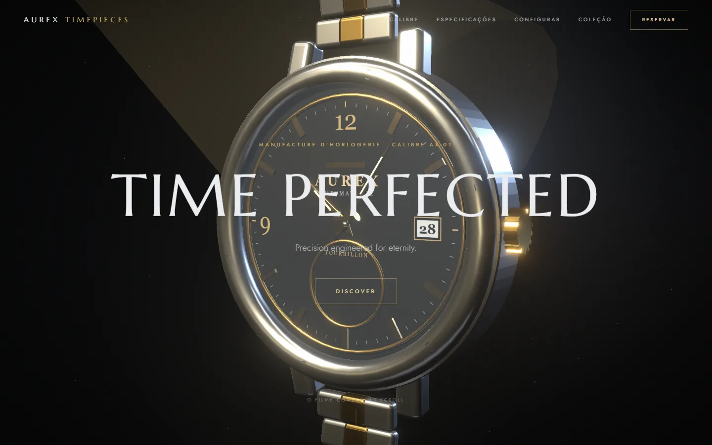

**English** · [Português](README.pt-BR.md)

# AUREX TIMEPIECES

Concept site for a **fictional** haute horlogerie brand. The watch (Calibre AX-01 Tourbillon) is modeled in code with Three.js and comes apart and reassembles piece by piece as you scroll. Portfolio project by [MilWeb](https://milweb.com.br).

> **Type:** concept (fictional brand, not affiliated with any real watchmaker) · **Demo:** https://aurex-timepieces.vercel.app



## Features

- Fully procedural 3D watch (`src/components/scene/watch.tsx`), with no external models or textures. Gears, rotor and tourbillon keep moving continuously.
- Per-scene camera script (`src/lib/scenes.ts`): each section marked with `data-scene` moves the camera and drives the disassembly.
- Case, dial and hands configurator, swapping materials without re-rendering the 3D scene.
- Gallery, spec sheet and finale, with scroll animations (GSAP) and smooth scrolling (Lenis).
- Honors `prefers-reduced-motion` in text animations and the finale.
- `sitemap` and `robots` generated by the App Router.

## Stack

Next.js 15 (App Router, Turbopack), React 19, TypeScript, Tailwind CSS 4, Three.js with React Three Fiber, drei and postprocessing, GSAP, Lenis, Framer Motion. Marcellus and Jost fonts via `next/font/google`.

## Architecture

- `src/lib/world.ts`: mutable state shared between the DOM and the 3D scene (scroll, pointer, configuration). It is read inside `useFrame`, so scrolling does not re-render React.
- `src/components/scene-tracker.tsx`: registers one ScrollTrigger per section and writes the current scene and progress into `world`.
- `src/components/scene/camera-rig.tsx`: interpolates the camera script with damping.
- `src/components/sections/`: page sections (hero, film, specs, configurator, gallery, finale).

## Getting started

Prerequisites: Node.js 18.18+ (CI uses Node 22) and npm.

```bash
npm ci
npm run dev      # development server (Turbopack)
npm run build    # production build
npm run start    # serve the build
npm run lint     # ESLint
npx tsc --noEmit # type check
```

There are no environment variables. Site name and URL live in `src/lib/site.ts`.

## Limitations

- Content, contact (`atelier@aurextimepieces.example`) and boutiques are fictional; the contact button only opens a `mailto:` link.
- UI copy is in Portuguese, with English display headlines.
- The 3D scene requires WebGL and is heavy on low-end devices.
- No automated tests; CI runs lint, type check and build.

## Security

See [SECURITY.md](SECURITY.md).

## License

No license has been chosen yet; all rights reserved by the author.
